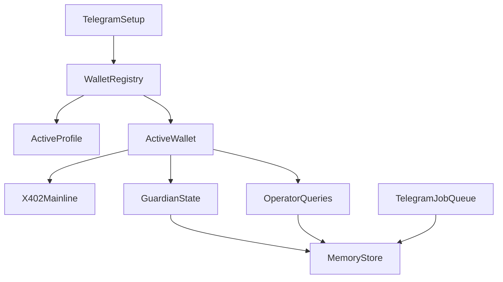

# AgentPhalanx Telegram + Agentic Wallet Productization Implementation Plan

> **For agentic workers:** REQUIRED: Use superpowers:subagent-driven-development (if subagents available) or superpowers:executing-plans to implement this plan. Steps use checkbox (`- [ ]`) syntax for tracking.

**Goal:** Make AgentPhalanx behave like the intended product: Telegram-first operator control, multi-Gmail / multi-Agentic-wallet management, Agentic-wallet-backed x402 payment with X Layer priority, resumable Guardian state, and a queueable/cancellable operator workflow suitable for long-running local operation.

**Architecture:** Keep [src/app/host.ts](Phalanx-Skill/src/app/host.ts) as the composition root and avoid broad rewrites. Formalize an Agentic wallet registry with `profiles[]`, `wallets[]`, `activeProfileId`, and `activeWalletId`; route OmRate/x402 through that active wallet; add an explicit Telegram job queue surface instead of overloading approval state; and introduce a small memory/state bridge for Guardian resumability rather than scattering persistence logic across Telegram, host, and adapters.

**Tech Stack:** TypeScript, Node.js, grammy, existing Phalanx runtime/host/telegram modules, Onchain OS CLI, OmRate/x402 integration, MCP-compatible memory service, Vitest.

---

## Scope And Non-Goals

**In scope:**

- make OmRate/x402 mainline use the active Agentic wallet path, with `eip155:196` preferred over `eip155:8453`
- add deterministic accept selection and balance-aware fallback logic
- replace single-email / single-wallet assumptions with a multi-profile wallet registry
- add Telegram job queue, sequence display, cancel/edit callbacks, and observable pending state
- persist Guardian/operator state through a memory service so restart recovery is not purely in-memory
- package the runtime for longer-lived local operation (`npm start` / PM2 / docs)

**Out of scope for this round:**

- replacing Onchain OS as the signing/execution substrate
- turning Telegram into an open-ended chat assistant
- broad frontend/web UI work
- building a full cloud account system or hosted wallet console
- unrelated adapter rewrites outside the wallet-registry / x402 / queue / memory path

---

## Product Decisions

- The registry source of truth becomes `profiles[]`, not single-value `OKX_AGENTIC_WALLET_LOGIN_EMAIL` / `OKX_AGENTIC_WALLET_CURRENT_ADDRESS`.
- Each profile contains at least: `profileId`, `email`, `wallets[]`, `createdAt`, `lastUsedAt`.
- Each wallet contains at least: `walletId`, `address`, `label`, `chains`, `createdAt`, `lastUsedAt`, `fundingHints`.
- Runtime always resolves one `activeProfileId` and one `activeWalletId`; x402 payer, Guardian, operator queries, queue execution, and reserve warnings all use that active wallet.
- Sensitive credentials stay in local config/env; registry shape and recoverable runtime state go to config + memory with explicit separation.
- The system must support both wallet auto-discovery and manual wallet recording under a Gmail profile; it must not assume OKX always enumerates all wallets for a given email.

## Memory Contract

- Long-term memory is schema-driven and event-driven, not free-form LLM note taking.
- Deterministic runtime layers (`host`, `guardian`, `queue`, `setup`, `x402 execution`) own memory writes for hard state transitions.
- LLM may propose preference updates, but preference memory is only written after explicit user confirmation or a structured settings action succeeds.
- New operator/guardian reasoning must retrieve a relevant memory slice before model execution; the system must not rely on the model "remembering" prior context by itself.

### Persist Always

- active profile / active wallet changes
- wallet registry mutations
- pending job lifecycle changes
- approval lifecycle changes
- latest `portfolio_state`
- `action_history`
- latest Guardian assessment summary
- x402 reserve balance summary
- x402 payment result summary

### Persist On Confirmation Only

- user preferences
- risk tolerance / allocation style
- Guardian cadence / interval settings
- notification preferences

### Never Persist

- raw secrets
- OTP codes
- raw API credentials
- unconfirmed conversational guesses
- incidental chat text that does not map to a structured state change

---

## File Map

**Create:**

- [src/adapters/x402-accept-selection.ts](Phalanx-Skill/src/adapters/x402-accept-selection.ts) — sort/filter `accepts[]`, prefer X Layer, evaluate fallback decisions, and produce explicit selection diagnostics
- [src/adapters/x402-balance-probe.ts](Phalanx-Skill/src/adapters/x402-balance-probe.ts) — read asset sufficiency for the active Agentic wallet on candidate chains using injectable hooks
- [src/adapters/x402-agentic-payment.ts](Phalanx-Skill/src/adapters/x402-agentic-payment.ts) — mainline x402 execution via Onchain OS `payment x402-pay` and proof replay helpers
- [src/config/agentic-wallet-registry.ts](Phalanx-Skill/src/config/agentic-wallet-registry.ts) — registry model, migration helpers, active profile/wallet resolution
- [src/telegram/job-queue.ts](Phalanx-Skill/src/telegram/job-queue.ts) — queue model, job ids, ordering, cancel/edit transitions, and serialization helpers
- [src/memory/state-store.ts](Phalanx-Skill/src/memory/state-store.ts) — small interface over memory persistence/recovery for portfolio state, user preferences, action history, x402 reserve cache, and active wallet context
- [src/memory/mcp-memory-store.ts](Phalanx-Skill/src/memory/mcp-memory-store.ts) — MCP-backed implementation for the state-store interface
- [scripts/start-runtime.ts](Phalanx-Skill/scripts/start-runtime.ts) — stable long-running local entrypoint suitable for PM2 / operator docs
- [ecosystem.config.cjs](Phalanx-Skill/ecosystem.config.cjs) — PM2 runtime configuration
- [docs/product/agentphalanx-review-narrative.md](Phalanx-Skill/docs/product/agentphalanx-review-narrative.md) — one-page product narrative for reviewers

**Modify:**

- [src/adapters/x402.ts](Phalanx-Skill/src/adapters/x402.ts) — stop treating `PHALANX_X402_PRIVATE_KEY` + single-network wrapped fetch as the default product path; keep it only as fallback/debug if still needed
- [src/adapters/omrate.ts](Phalanx-Skill/src/adapters/omrate.ts) — route x402-required requests through accept-selection + active Agentic wallet payment path
- [src/adapters/onchainos.ts](Phalanx-Skill/src/adapters/onchainos.ts) — support selected-accept network input and any additional parsing needed for x402 payment evidence
- [src/runtime/execution-evidence.ts](Phalanx-Skill/src/runtime/execution-evidence.ts) — surface selected network, selected asset, active profile/wallet, payment id, and reserve state
- [src/runtime/events.ts](Phalanx-Skill/src/runtime/events.ts) — add structured event metadata for x402 selection/fallback/funding failures and active wallet context
- [src/app/host.ts](Phalanx-Skill/src/app/host.ts) — wire queue + memory store + registry + x402 reporting, while keeping public `PhalanxHost` shape as stable as possible
- [src/guardian/service.ts](Phalanx-Skill/src/guardian/service.ts) — load saved state on startup, write refreshed state after each cycle, support configurable interval semantics, and use the active wallet
- [src/telegram/setup.ts](Phalanx-Skill/src/telegram/setup.ts) — upgrade the setup wizard from single email/current-address persistence to registry-aware profile and wallet recording
- [src/telegram/live.ts](Phalanx-Skill/src/telegram/live.ts) — queue display, cancel/edit callbacks, slash commands, richer completion summaries, and profile/wallet management actions
- [src/telegram/operator-catalog.ts](Phalanx-Skill/src/telegram/operator-catalog.ts)
- [src/telegram/operator-formatters.ts](Phalanx-Skill/src/telegram/operator-formatters.ts)
- [src/telegram/operator-queries.ts](Phalanx-Skill/src/telegram/operator-queries.ts)
- [src/index.ts](Phalanx-Skill/src/index.ts) — support the packaged start path and lifecycle wiring
- [src/config/store.ts](Phalanx-Skill/src/config/store.ts) — clarify x402 network override semantics, registry config semantics, and runtime defaults
- [config.env.example](Phalanx-Skill/config.env.example)
- [service.env.example](Phalanx-Skill/service.env.example)
- [README.md](Phalanx-Skill/README.md)
- [docs/live-demo-runbook.md](Phalanx-Skill/docs/live-demo-runbook.md)
- [docs/hackathon/xlayer-demo-checklist.md](Phalanx-Skill/docs/hackathon/xlayer-demo-checklist.md)
- [package.json](Phalanx-Skill/package.json)

**Test:**

- [tests/adapter-contracts.test.ts](Phalanx-Skill/tests/adapter-contracts.test.ts)
- [tests/demo-rebalance-flow.test.ts](Phalanx-Skill/tests/demo-rebalance-flow.test.ts)
- [tests/execution-evidence.test.ts](Phalanx-Skill/tests/execution-evidence.test.ts)
- [tests/install-operator.test.ts](Phalanx-Skill/tests/install-operator.test.ts)
- [tests/operator-providers.test.ts](Phalanx-Skill/tests/operator-providers.test.ts)
- [tests/runtime-host.test.ts](Phalanx-Skill/tests/runtime-host.test.ts)
- [tests/telegram-live.test.ts](Phalanx-Skill/tests/telegram-live.test.ts)
- [tests/telegram-operator-router.test.ts](Phalanx-Skill/tests/telegram-operator-router.test.ts)
- [tests/transport-live.test.ts](Phalanx-Skill/tests/transport-live.test.ts)
- new focused tests:
  - [tests/x402-accept-selection.test.ts](Phalanx-Skill/tests/x402-accept-selection.test.ts)
  - [tests/x402-agentic-payment.test.ts](Phalanx-Skill/tests/x402-agentic-payment.test.ts)
  - [tests/telegram-job-queue.test.ts](Phalanx-Skill/tests/telegram-job-queue.test.ts)
  - [tests/memory-state-store.test.ts](Phalanx-Skill/tests/memory-state-store.test.ts)
  - [tests/agentic-wallet-registry.test.ts](Phalanx-Skill/tests/agentic-wallet-registry.test.ts)

---

## Architecture

---

## Chunk 1: Replace Single-Wallet Assumptions With A Registry

### Task 1: Add a first-class multi-Gmail / multi-wallet registry

**Files:**

- Create: [src/config/agentic-wallet-registry.ts](Phalanx-Skill/src/config/agentic-wallet-registry.ts)
- Modify: [src/config/store.ts](Phalanx-Skill/src/config/store.ts)
- Modify: [config.env.example](Phalanx-Skill/config.env.example)
- Test: [tests/agentic-wallet-registry.test.ts](Phalanx-Skill/tests/agentic-wallet-registry.test.ts)
- Test: [tests/config-store.test.ts](Phalanx-Skill/tests/config-store.test.ts)
- **Step 1: Write the failing registry-model tests**

Cover:

- migration from current single-value fields into `profiles[]`
- multiple Gmail profiles
- multiple wallets under one Gmail
- active profile / active wallet resolution
- missing-active fallback rules
- **Step 2: Run the focused registry tests to verify failure**

Run: `npm run test -- tests/agentic-wallet-registry.test.ts tests/config-store.test.ts`

Expected: FAIL because runtime config still assumes one email / one current wallet

- **Step 3: Implement the registry model and migration path**

Implementation notes:

- preserve backward-compatible reads from existing single-value fields
- make the new registry the primary write target
- keep secrets out of the registry model
- **Step 4: Re-run the focused registry tests**

Run: `npm run test -- tests/agentic-wallet-registry.test.ts tests/config-store.test.ts`

Expected: PASS

---

## Chunk 2: Make x402 Mainline Match The Product

### Task 2: Replace the current default x402 buyer path with active-Agentic-wallet payment

**Files:**

- Create: [src/adapters/x402-accept-selection.ts](Phalanx-Skill/src/adapters/x402-accept-selection.ts)
- Create: [src/adapters/x402-balance-probe.ts](Phalanx-Skill/src/adapters/x402-balance-probe.ts)
- Create: [src/adapters/x402-agentic-payment.ts](Phalanx-Skill/src/adapters/x402-agentic-payment.ts)
- Modify: [src/adapters/x402.ts](Phalanx-Skill/src/adapters/x402.ts)
- Modify: [src/adapters/omrate.ts](Phalanx-Skill/src/adapters/omrate.ts)
- Modify: [src/adapters/onchainos.ts](Phalanx-Skill/src/adapters/onchainos.ts)
- Modify: [src/runtime/execution-evidence.ts](Phalanx-Skill/src/runtime/execution-evidence.ts)
- Test: [tests/x402-accept-selection.test.ts](Phalanx-Skill/tests/x402-accept-selection.test.ts)
- Test: [tests/x402-agentic-payment.test.ts](Phalanx-Skill/tests/x402-agentic-payment.test.ts)
- Test: [tests/adapter-contracts.test.ts](Phalanx-Skill/tests/adapter-contracts.test.ts)
- **Step 1: Write the failing accept-selection tests**

Cover:

- `eip155:196` beats `eip155:8453` when both are present and payable
- `eip155:8453` is chosen when X Layer is present but insufficient
- the selected payer is the active Agentic wallet, not an unrelated buyer wallet
- explicit failure is returned when no candidate is payable
- debug override semantics for `PHALANX_X402_NETWORK` are documented in behavior, not as a silent default
- **Step 2: Run the focused selection tests to verify failure**

Run: `npm run test -- tests/x402-accept-selection.test.ts tests/x402-agentic-payment.test.ts`

Expected: FAIL because current mainline does not select across `accepts[]` and does not resolve the active wallet registry

- **Step 3: Implement accept ranking and sufficiency checks**

Implementation notes:

- rank by product policy first: `eip155:196` then `eip155:8453`
- evaluate asset sufficiency against the active wallet address, not a naked private-key buyer
- return structured failure states such as `no_supported_accept`, `insufficient_funds`, `selection_blocked`
- **Step 4: Wire OmRate execution through the active Agentic wallet payment path**

Implementation notes:

- use the selected accept's `network`, `amount`, `asset`, and `payTo`
- call Onchain OS `payment x402-pay` for the selected accept
- replay with `X-PAYMENT`
- keep old wrapped-fetch path only as an explicit fallback/debug branch if still needed
- **Step 5: Add runtime evidence for selected profile, wallet, network, and settlement**

Cover:

- selected profile id/email
- selected wallet address/id
- selected network (`196` / `8453`)
- selected asset symbol/address
- wallet source (`agentic_active_wallet`, `override`, `debug_private_key_fallback`)
- payment id / settlement result when the server returns it
- **Step 6: Re-run focused x402 tests**

Run: `npm run test -- tests/x402-accept-selection.test.ts tests/x402-agentic-payment.test.ts tests/adapter-contracts.test.ts tests/execution-evidence.test.ts`

Expected: PASS

---

## Chunk 3: Make Telegram Behave Like A Real Operator Surface

### Task 3: Add a queue with sequence numbers, cancel, edit, and active-wallet management

**Files:**

- Create: [src/telegram/job-queue.ts](Phalanx-Skill/src/telegram/job-queue.ts)
- Modify: [src/telegram/setup.ts](Phalanx-Skill/src/telegram/setup.ts)
- Modify: [src/app/host.ts](Phalanx-Skill/src/app/host.ts)
- Modify: [src/telegram/live.ts](Phalanx-Skill/src/telegram/live.ts)
- Modify: [src/telegram/operator-formatters.ts](Phalanx-Skill/src/telegram/operator-formatters.ts)
- Modify: [src/telegram/operator-catalog.ts](Phalanx-Skill/src/telegram/operator-catalog.ts)
- Modify: [src/telegram/operator-queries.ts](Phalanx-Skill/src/telegram/operator-queries.ts)
- Test: [tests/telegram-job-queue.test.ts](Phalanx-Skill/tests/telegram-job-queue.test.ts)
- Test: [tests/telegram-live.test.ts](Phalanx-Skill/tests/telegram-live.test.ts)
- Test: [tests/transport-live.test.ts](Phalanx-Skill/tests/transport-live.test.ts)
- Test: [tests/telegram-setup.test.ts](Phalanx-Skill/tests/telegram-setup.test.ts)
- **Step 1: Write the failing queue and profile-management tests**

Cover:

- enqueue 3 jobs and render stable `#1/#2/#3` ordering
- cancel removes the targeted job only
- edit transitions the job into an editable pending state and prompts for new parameters
- Telegram can show profiles, show wallets, set active profile, and set active wallet
- queue state remains separate from approval router state
- **Step 2: Run the focused Telegram tests to verify failure**

Run: `npm run test -- tests/telegram-job-queue.test.ts tests/telegram-live.test.ts tests/telegram-setup.test.ts`

Expected: FAIL because only approval queue exists today and setup is still single-profile

- **Step 3: Implement queue storage, callback routing, and profile/wallet actions**

Implementation notes:

- each job gets a uuid and display sequence
- callback data carries job id + action in a bounded format
- add bounded operator actions instead of open-ended free text
- do not overload approval queue entries with edit/cancel behavior unrelated to approvals
- **Step 4: Add queue rendering and active-wallet summaries**

Cover:

- `waiting... (N ahead)` rendering
- grouped pending jobs view
- active email / active wallet display
- completion/removal summaries when jobs execute or are cancelled
- **Step 5: Re-run focused Telegram tests**

Run: `npm run test -- tests/telegram-job-queue.test.ts tests/telegram-live.test.ts tests/transport-live.test.ts tests/telegram-setup.test.ts`

Expected: PASS

---

## Chunk 4: Persist Guardian State Across Restarts

### Task 4: Integrate a memory-backed state store

**Files:**

- Create: [src/memory/state-store.ts](Phalanx-Skill/src/memory/state-store.ts)
- Create: [src/memory/mcp-memory-store.ts](Phalanx-Skill/src/memory/mcp-memory-store.ts)
- Modify: [src/guardian/service.ts](Phalanx-Skill/src/guardian/service.ts)
- Modify: [src/app/host.ts](Phalanx-Skill/src/app/host.ts)
- Modify: [src/config/store.ts](Phalanx-Skill/src/config/store.ts)
- Test: [tests/memory-state-store.test.ts](Phalanx-Skill/tests/memory-state-store.test.ts)
- Test: [tests/guardian-cycle.test.ts](Phalanx-Skill/tests/guardian-cycle.test.ts)
- Test: [tests/runtime-host.test.ts](Phalanx-Skill/tests/runtime-host.test.ts)
- **Step 1: Write the failing state-persistence tests**

Cover:

- Guardian writes `portfolio_state` after a cycle
- restart loads the most recent `portfolio_state`
- `user_preferences`, `action_history`, `x402_balance`, active profile, active wallet, and pending jobs survive process restart
- deterministic runtime events write memory without relying on the LLM to summarize them
- preference-like memory writes require explicit confirmation or structured settings success
- operator/guardian reasoning retrieves a relevant memory slice before model execution
- missing/unavailable memory service degrades cleanly instead of crashing startup
- **Step 2: Run the focused memory tests to verify failure**

Run: `npm run test -- tests/memory-state-store.test.ts tests/guardian-cycle.test.ts`

Expected: FAIL because no memory-backed runtime state exists today

- **Step 3: Implement the memory store interface and MCP-backed adapter**

Implementation notes:

- keep a small, explicit interface so runtime code is not tied directly to MCP protocol details
- separate `loadLatestState()` and `persistCycleState()` paths
- record enough metadata to debug stale-state issues (`updatedAt`, `chain`, `source`, `activeWalletId`)
- separate deterministic writes (`persistRuntimeEventState`) from preference writes (`persistConfirmedPreferencePatch`)
- add a retrieval path such as `loadReasoningContext(input)` that returns only the minimum relevant memory slice for the current action/query
- **Step 4: Wire Guardian startup and post-cycle persistence**

Cover:

- startup restore
- post-cycle save
- reserve-cache update for x402 balance warnings
- active-wallet-aware portfolio recovery
- pre-reasoning memory retrieval for Guardian decision-making and operator action planning
- **Step 5: Re-run focused memory tests**

Run: `npm run test -- tests/memory-state-store.test.ts tests/guardian-cycle.test.ts tests/runtime-host.test.ts`

Expected: PASS

---

## Chunk 5: Package The Runtime For Real Local Operation

### Task 5: Make runtime startup and long-running behavior production-like

**Files:**

- Create: [scripts/start-runtime.ts](Phalanx-Skill/scripts/start-runtime.ts)
- Create: [ecosystem.config.cjs](Phalanx-Skill/ecosystem.config.cjs)
- Modify: [src/index.ts](Phalanx-Skill/src/index.ts)
- Modify: [package.json](Phalanx-Skill/package.json)
- Modify: [src/guardian/service.ts](Phalanx-Skill/src/guardian/service.ts)
- Test: [tests/install-operator.test.ts](Phalanx-Skill/tests/install-operator.test.ts)
- Test: [tests/repo-layout.test.ts](Phalanx-Skill/tests/repo-layout.test.ts)
- **Step 1: Write failing startup/packaging tests**

Cover:

- a stable `npm start` entrypoint exists
- PM2 config points to the packaged runtime entry
- Guardian interval defaults are documented and configurable for long-lived operation
- startup wiring restores memory-backed active wallet context before background work begins
- **Step 2: Run the focused packaging tests to verify failure**

Run: `npm run test -- tests/install-operator.test.ts tests/repo-layout.test.ts`

Expected: FAIL because there is no `npm start` / PM2 packaging contract today

- **Step 3: Add `npm start`, PM2 config, and interval semantics**

Implementation notes:

- keep `npm run dev` for local dev
- add `npm start` as the operator-facing long-running entry
- keep Guardian interval configurable, but document the product default separately from test-friendly intervals
- **Step 4: Re-run focused packaging tests**

Run: `npm run test -- tests/install-operator.test.ts tests/repo-layout.test.ts`

Expected: PASS

---

## Chunk 6: Align Docs With The Intended Product

### Task 6: Update README, runbook, checklist, and reviewer narrative

**Files:**

- Create: [docs/product/agentphalanx-review-narrative.md](Phalanx-Skill/docs/product/agentphalanx-review-narrative.md)
- Modify: [README.md](Phalanx-Skill/README.md)
- Modify: [docs/live-demo-runbook.md](Phalanx-Skill/docs/live-demo-runbook.md)
- Modify: [docs/hackathon/xlayer-demo-checklist.md](Phalanx-Skill/docs/hackathon/xlayer-demo-checklist.md)
- Modify: [config.env.example](Phalanx-Skill/config.env.example)
- Modify: [service.env.example](Phalanx-Skill/service.env.example)
- **Step 1: Write the reviewer-facing narrative**

It must clearly explain:

- AgentPhalanx is Telegram-first and local-first
- OmRate/x402 payment uses the active Agentic wallet
- X Layer is preferred, Base is fallback
- one user may manage multiple Gmail identities and multiple Agentic wallets
- default demo cut is deposit, fuller story is allocation/x402
- **Step 2: Update operator docs**

Cover:

- preload X Layer USDT into the active Agentic wallet before paid OmRate access
- explain gas-free X Layer boundary without implying the asset itself is free
- explain queue/cancel/edit behavior
- explain restart recovery from memory
- explain `npm start` / PM2 flow
- explain what goes to config, what goes to memory, and what never enters memory
- explain that the model does not receive the entire memory dump every turn; it receives a relevant memory slice assembled by the runtime
- **Step 3: Re-read docs for consistency**

Check that:

- README, runbook, checklist, and reviewer narrative say the same thing
- no doc still claims the default x402 path is a naked private key
- no doc claims PM2 or memory features exist without matching implementation
- no doc still implies a single Gmail / single wallet source of truth

---

## Final Verification

- **Step 1: Run focused feature suites**

Run:

`npm run test -- tests/agentic-wallet-registry.test.ts tests/x402-accept-selection.test.ts tests/x402-agentic-payment.test.ts tests/telegram-job-queue.test.ts tests/memory-state-store.test.ts tests/runtime-host.test.ts tests/telegram-live.test.ts`

Expected: PASS

- **Step 2: Run full verification**

Run:

`npm run test && npm run build && npm run guard:ai`

Expected: PASS

- **Step 3: Run live/manual proof checks**

Run:

- `PHALANX_X402_SMOKE_BASE_URL="https://api.omrate.com" npm run smoke:x402`
- the relevant Telegram/private-chat manual flow

Expected:

- the active Agentic wallet is the payer
- selected payment network is `eip155:196` when funded
- Base fallback only occurs when X Layer cannot pay
- Telegram queue/approval/reporting are observable
- switching active profile / wallet changes the payer resolution used by x402

---

## Acceptance Criteria

This plan is complete only when:

- multi-Gmail / multi-wallet registry replaces single-wallet assumptions as the runtime source of truth
- one active wallet is always resolvable for x402, Guardian, Telegram queue, and operator queries
- OmRate mainline x402 uses the active Agentic wallet path by default
- X Layer is preferred over Base using explicit selection logic
- Telegram has a real queue with cancel/edit, not just approval buttons
- Guardian state survives restart through a memory-backed store
- memory writes are deterministic for hard state changes, confirmed-only for preferences, and never store secrets
- new operator/guardian reasoning always reads a relevant memory slice before model execution
- the repo has a stable long-running local start path (`npm start` / PM2)
- docs describe the same product the code actually runs

Plan complete and saved to [docs/superpowers/plans/2026-04-15-agentphalanx-telegram-agentic-wallet-productization.md](Phalanx-Skill/docs/superpowers/plans/2026-04-15-agentphalanx-telegram-agentic-wallet-productization.md). Ready to execute?